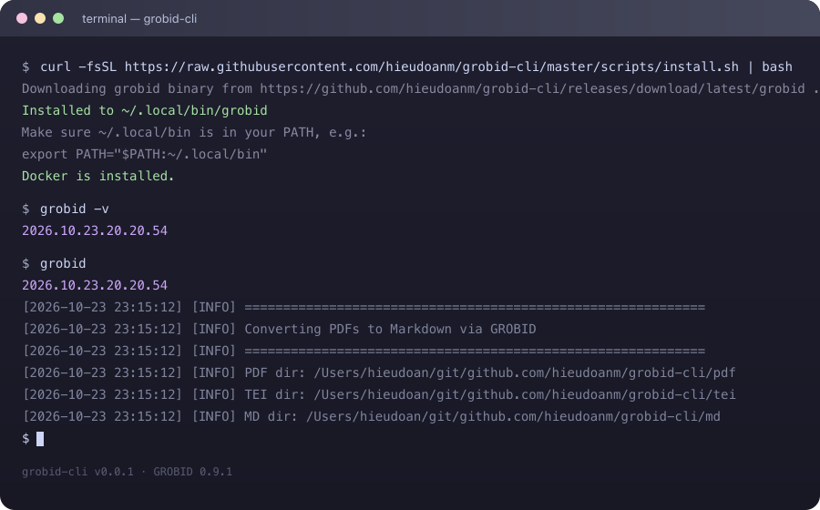

# grobid.rs

[](https://github.com/hieudoanm/grobid.rs/actions/workflows/ci.yaml?branch=master)  [](LICENSE)


**Convert PDF articles to Markdown via GROBID TEI XML — making PDFs AI-friendly on your own machine.**

grobid.rs is a local, focused document-conversion tool. Drop PDFs into a `pdf/` directory, run the `grobid` command, and get clean, structured Markdown with rich metadata in YAML frontmatter — plus TEI XML intermediates. Everything runs locally — no cloud account or infrastructure setup.

## Table of Contents

- [The Problem](#the-problem)
- [The Solution](#the-solution)
- [Features](#features)
- [Key Benefits](#key-benefits)
- [See It in Action](#see-it-in-action)
- [Get Started](#get-started)
- [Use Cases](#use-cases)
- [Why This Project?](#why-this-project)
- [Project Status and Trust](#project-status-and-trust)
- [Community and Contributions](#community-and-contributions)
- [Call to Action](#call-to-action)
- [License](#license)

<p align="center">
  
</p>

## The Problem

AI models struggle to extract clean, structured content from PDFs. Raw PDFs are messy — headers, footers, citations, tables, and figures make it hard for LLMs to parse and reason about academic papers or documents. Raw text extraction loses structure, citations break context, and formatting confuses models.

A useful local conversion tool needs to make it possible to:

- Drop PDFs into a `pdf/` directory and convert them in one command.
- Auto-start GROBID on port 8070 if it is not already running — either a locally installed JVM service (no Docker) or a Docker container.
- Extract title, authors, journal, year, volume, issue, pages, and DOI as YAML frontmatter.
- Preserve abstract, article sections, references, tables, lists, and formulas.
- Convert resumably: skip TEI and Markdown files that already exist.
- Run the whole system with Docker Compose: the GROBID service on port 8070. Optional — a local JVM GROBID install works without Docker.

grobid.rs brings these workflows together in one coherent application.

## The Solution

grobid.rs provides a focused, local-first workflow: drop PDFs into `pdf/`, run `grobid`, review the Markdown in `md/` (with TEI XML in `tei/`). It uses GROBID's state-of-the-art PDF parsing to produce clean, structured Markdown that LLMs can understand and reason about effectively, behind one `pdf/` → `tei/` → `md/` pipeline, with metadata captured as YAML frontmatter. Everything runs locally — Docker is optional; a native JVM GROBID install works just as well.

## Features

- **PDF → TEI → Markdown** — Full conversion pipeline using GROBID's TEI XML extraction via `grobid` client (`processFulltextDocument`).
- **Auto-starts GROBID** — Launches the GROBID service on port 8070 if not already running: prefers a locally installed JVM distribution (`scripts/setup-grobid-local.sh`, no Docker) and falls back to the `grobid/grobid:0.9.1-crf` Docker container.
- **Rich metadata** — Extracts title, authors, journal, year, volume, issue, pages, DOI, and DOI link and adds them as YAML frontmatter.
- **DOI-linked references** — Reference entries carrying a DOI render their titles as `https://doi.org/…` links.
- **Crossref enrichment** — Optional `--enrich`/`GROBID_ENRICH` resolves works against the Crossref API to fill type, citation count, and abstract gaps.
- **SQLite corpus index** — Every converted work and its citation edges are indexed into `.grobid/grobid.db`, with a JSON export, per-work metadata files, and a run manifest.
- **Corpus search & stats** — `grobid search` (unified substring search) and `grobid stats` (counts, year histogram, top authors, in/out-degree citation rankings).
- **Corpus dashboard** — Every run writes a self-contained `.grobid/index.html`: an Obsidian-style d3-force citation graph with stats sidebar, year-distribution chart, and one unified filter (`grobid graph` regenerates it).
- **MCP server** — `grobid mcp` exposes the corpus (stats, search, works, graph) to AI agents over stdio.
- **Structured output** — Preserves abstract, article sections, references, tables, lists, and figures.
- **Simple CLI** — One command (`grobid`) converts all PDFs in `pdf/` to TEI in `tei/` and Markdown in `md/`.
- **Resumable** — Skips already-converted TEI/XML and Markdown files; auto-creates directories.

## Key Benefits

- **Local-first & private** — Convert on your own machine. Your documents never leave your environment.
- **PDFs to Markdown in minutes** — One command turns a folder of PDFs into LLM-ready Markdown with metadata.
- **Honest conversion** — GROBID's TEI XML is the intermediate format; Markdown renders TEI faithfully with no information loss layer.
- **Reproducible by design** — Every run records data directory, ports, image, container name, and library versions.
- **Developer-friendly** — Rust CLI (`cargo`), static landing page, Docker Compose topology, `clippy`/`cargo test` tooling.

## See It in Action



Or read the full documentation in [`docs/`](docs/README.md).

## Get Started

The fastest way to run grobid.rs locally:

### Prerequisites

- [Docker](https://www.docker.com/) and [Docker Compose](https://docs.docker.com/compose/) v2 — **optional**, only needed for the Docker backend
- GROBID itself — either the Docker image (auto-pulled) or a local JVM install via `scripts/setup-grobid-local.sh` (needs OpenJDK 21+; no Docker)
- Rust toolchain (only needed to build the CLI from source; a prebuilt binary is available)

### Run the stack

```sh
docker compose up --build
```

This starts the GROBID service on port 8070. The CLI auto-starts its own
container if needed, so Compose is optional for one-off runs.

Stop and clean up:

```sh
docker compose down -v
```

### CLI usage

1. Put your PDFs in a `pdf/` directory
2. Run the converter
3. Get TEI XML in `tei/` and Markdown in `md/`

```sh
grobid
```

Or set a custom data directory:

```sh
GROBID_DATA_DIR=/path/to/data grobid
```

### Output Example

```markdown
---
title: "Paper Title"
authors: "Author One, Author Two"
year: 2024
journal: "Journal Name"
volume: "10"
doi: "10.1234/example"
doi_link: "https://doi.org/10.1234/example"
---

# Paper Title

**Authors:** Author One, Author Two

## Abstract
...

## Article
...

## References
...
```

### Directory Structure

```
your-project/
├── pdf/          # Input PDFs
├── tei/          # Generated TEI XML (intermediate)
├── md/           # Output Markdown files
└── .grobid/      # Corpus artifacts: grobid.db, index.json, metadata/,
                  # process.json, index.html (dashboard)
```

### Corpus commands

After converting, the corpus can be searched, summarized, visualized, or
served to AI agents — all offline, straight from `.grobid/grobid.db`:

```sh
grobid search "stroke"     # unified search across title/authors/DOI/...
grobid stats               # counts, year histogram, top authors, rankings
grobid graph               # → .grobid/index.html (open in a browser)
grobid mcp                 # MCP server over stdio for AI agents
```

### Installation

#### Option 1: Prebuilt binary

```bash
# Download the latest binary
curl -fsSL https://github.com/hieudoanm/grobid.rs/releases/download/latest/grobid -o /usr/local/bin/grobid
chmod +x /usr/local/bin/grobid
```

Or use the install script — it downloads the binary and, if neither Docker
nor a local GROBID install is present, prints a hint for setting one up:

```bash
curl -fsSL https://raw.githubusercontent.com/hieudoanm/grobid.rs/master/scripts/install.sh | bash

# also build + install the local GROBID JVM service (needs OpenJDK 21+, no Docker)
curl -fsSL https://raw.githubusercontent.com/hieudoanm/grobid.rs/master/scripts/install.sh | bash -s -- --with-grobid
```

> **Note:** the release currently ships a single `linux/amd64` binary. On
> other platforms, build from source instead.

#### Option 2: From source

```bash
# Build and install to ~/.local/bin (or $INSTALL_DIR)
./scripts/install-local.sh

# also build + install the local GROBID JVM service (no Docker)
./scripts/install-local.sh --with-grobid

# or manually
cargo build --release
# binary at target/release/grobid
```

## Use Cases

- **Research paper ingestion** — Turn PDF corpora into LLM-ready Markdown with citation metadata.
- **Bibliography extraction** — Pull structured references and DOI links from academic PDFs.
- **Local document processing** — Keep sensitive documents on-device while converting to structured Markdown.
- **LLM-ready corpora** — Feed clean Markdown (not raw PDF text) into retrieval-augmented generation pipelines.

## Why This Project?

- **Focused scope** — Does one thing well: convert PDFs to Markdown via GROBID TEI XML. No AutoML bloat.
- **Transparent** — Clear pipeline (PDF → TEI → Markdown), TEI intermediates preserved, metadata as frontmatter.
- **Local-first** — Runs entirely on your machine via Docker Compose; no vendor lock-in or external dependencies.
- **Production-minded** — Real Rust CLI + dependency-free static landing page and binary releases.

## Project Status and Trust

- **Maturity:** Software demonstration (beta). PDF → TEI → Markdown conversion is implemented, including auto-starting GROBID, resumable conversion, and YAML frontmatter metadata.
- **License:** [MIT License](LICENSE) — see the `LICENSE` file for full terms.
- **Testing:** `cargo test` + `clippy` + `fmt` (CLI), `pre-commit` hooks, GitHub Actions CI.

## Community and Contributions

Contributions, bug reports, and feature suggestions are welcome. See existing resources:

- [AGENTS.md](AGENTS.md) — project overview, architecture, environment variables, tech stack, build & test
- [crates/README.md](crates/README.md) — CLI tool for batch conversion
- [packages/landing/README.md](packages/landing/README.md) — static landing page for the CLI

To report issues or propose changes, open an issue or pull request in this repository.

## Call to Action

**[Get Started](#get-started)** — Run grobid.rs locally in minutes and convert your first PDF.

## License

This project is licensed under the [MIT License](LICENSE).
